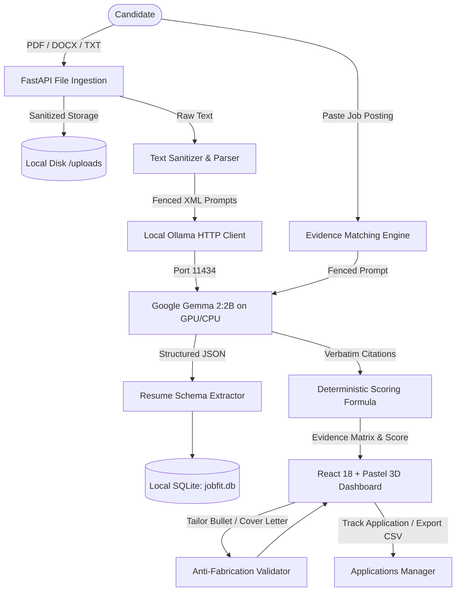

# JobFit — Local-First AI Job Application Assistant

> **JobFit** is an ethical, local-first AI career application copilot designed to empower candidates with **verifiable, evidence-backed job matching**, **grounded resume bullet tailoring**, and **truthful cover letter drafting** — operating with **zero cloud dependencies** and **zero external data transmission**.

---

## The Problem with Cloud Career Tools

1. **Severe Privacy Hazards**: Candidates upload their lifetime work histories, contact numbers, addresses, and compensation notes to third-party cloud LLM wrappers that log and train on sensitive personal records.
2. **Hallucinated "ATS Scores"**: Commercial resume matchers use black-box scoring algorithms that invent scores (e.g., "78% ATS Match") without explaining what is missing or citing proof.
3. **Fabricated Credentials**: Cloud AI rephrasers frequently invent numbers (e.g., changing *"built internal portal"* into *"scaled distributed architecture by 450% generating $12M"*), putting candidates at legal and ethical risk during background checks.

---

## The JobFit Solution

JobFit solves these problems by running **Google's Gemma 2:2B** completely on your local workstation via Ollama:

- **100% Offline & Local Sovereignty**: All resume text parsing, requirement extraction, bullet tailoring, and cover letters execute on `localhost`. 0 bytes leave your machine.
- **Verifiable Evidence Citations**: Every positive requirement match cites exact, verbatim sentences from your submitted resume.
- **Deterministic Scoring Engine**: A transparent mathematical formula ($Score = \frac{\text{Weighted Matches}}{\text{Total Requirements}} \times 100$) replaces opaque ATS claims.
- **Anti-Fabrication Guardrails**: Our tailoring engine programmatically inspects rewritten bullets to verify that no metrics, degrees, or employers have been invented.
- **Integrated Application Pipeline**: Track application states (`Saved`, `Preparing`, `Applied`, `Interview`, `Offer`, `Rejected`), export to CSV, and export evidence reports to Markdown.
- **One-Click Local Data Purge**: Completely wipe all SQLite records and local uploaded files from the UI at any time.

---

## System Architecture



---

## Key Features

### 1. Multi-Format Resume Ingestion
- Ingests **PDF**, **DOCX**, and **TXT** resumes (up to 5MB).
- Uses UUID-based local filenames to prevent path traversal attacks.
- Structured extraction: Contact Info, Professional Summary, Technical & Soft Skills, Experience Bullets, Projects, Education, and Certifications.
- Interactive structured profile editor to review and amend extracted fields.

### 2. Evidence-Backed Job Matching
- Paste any job posting to automatically extract must-have vs. nice-to-have qualifications.
- Correlates each requirement into:
  - `EXACT_MATCH`: Explicit resume evidence with verbatim quote.
  - `PARTIAL_MATCH`: Indirect or transferable experience identified.
  - `NOT_MENTIONED`: No evidence present in the submitted document.
  - `UNASSESSABLE`: Cannot be determined from written text.
- Never reports missing evidence as "candidate lacks capability" — distinguishes unmentioned text from genuine deficits.

### 3. Grounded Resume Tailoring & Guardrail Validator
- Select any bullet point from your resume and rephrase it for target job keywords.
- Strict **Anti-Fabrication Guardrail Validator**:
  - Automatically compares numbers and metrics between original and suggested text.
  - Rejects suggestions that invent percentages, dollar amounts, or unearned credentials.
  - Side-by-side diff with one-click "Accept", "Manual Edit", or "Copy".

### 4. Grounded Cover Letter Generator
- Generates personalized cover letters citing genuine candidate projects and experiences.
- Strict **Placeholder Policy**: If specific company motivation or cultural details are unstated, it inserts explicit bracketed tokens like `[Specific reason you admire Company X]` rather than making up false stories.
- In-browser markdown editor with 1-click Markdown / Plain Text export.

### 5. Application Pipeline & CSV Export
- Track jobs through `Saved`, `Preparing`, `Applied`, `Interview`, `Offer`, `Rejected`, and `Withdrawn`.
- Filterable table view and Kanban board view.
- 1-click export of application records to standard `.csv`.
- Export comprehensive evidence analysis reports to `.md`.

---

## Quickstart Guide

### Prerequisites
- **Node.js** 18+ and `npm`
- **Python** 3.10+ (tested on Python 3.11)
- **Ollama** installed ([ollama.com](https://ollama.com))

### Step 1: Start Ollama and Pull Gemma 2:2B
```bash
# Pull and start the recommended Gemma 2:2B model
ollama run gemma2:2b
```

### Step 2: Clone and Setup Backend
```bash
git clone https://github.com/Samar-365/jobfit.git
cd jobfit/jobfit/backend

# Create virtual environment (optional but recommended)
python -m venv venv
# On Windows:
.\venv\Scripts\activate
# On Linux/macOS:
source venv/bin/activate

# Install dependencies
pip install -r requirements.txt

# Start backend server (runs on port 8000)
python -m uvicorn app.main:app --host 127.0.0.1 --port 8000 --reload
```

### Step 3: Setup Frontend
```bash
cd ../frontend

# Install dependencies
npm install

# Start Vite development server (runs on port 5173)
npm run dev
```

Open your browser to **`http://localhost:5173`**.

---

## Benchmark Highlights (Gemma 2:2B)

Evaluated across 5 synthetic candidate archetypes on an NVIDIA RTX 4050 Laptop GPU:

| Archetype | Measured Latency | Match Score | Evidence Citation Rate | Prompt Injection Defense |
|:---|:---:|:---:|:---:|:---:|
| **Junior Frontend (College Grad)** | 16.53s | **65.8%** | **100%** | Passed |
| **Mid-Level Fullstack applying for Senior Backend** | 17.15s | **43.8%** | **50%** | Passed |
| **Marketing Specialist to Product Manager (Switcher)** | 14.84s | **50.0%** | **100%** | Passed |
| **Severe Gaps (Graphic Designer to Embedded Firmware)** | 16.42s | **0.0%** | **100%** | Passed |
| **Adversarial Resume (Hostile Injection Overrides)** | 13.79s | **70.0%** | **100%** | **Overridden (Passed)** |

See [`BENCHMARKS.md`](BENCHMARKS.md) for full reproduction steps, prompt boundaries, and hardware disclosure.

---

## Automated Test Suite

JobFit includes comprehensive backend unit & integration tests plus TypeScript static analysis:

```bash
# Backend pytest suite (37+ tests)
cd jobfit/backend
python -m pytest -v

# Frontend type check & build validation
cd ../frontend
npm run build
```

---

## Privacy & Security Guarantees

1. **Zero External API Calls**: JobFit has no API keys, cloud proxies, or tracking SDKs.
2. **Local Data Wiping**: The "Purge Local Data" action in Settings completely purges all SQLite records and local files in `uploads/`.
3. **Prompt Boundary Isolation**: All user-supplied resume and job description texts are encapsulated in rigid XML tags (`<resume_document>`, `<target_job_posting>`) with system instructions strictly forbidding instruction overrides.

---

## License

This project is licensed under the [MIT License](LICENSE).